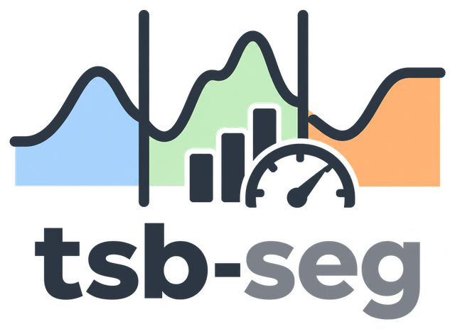
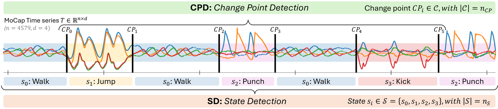
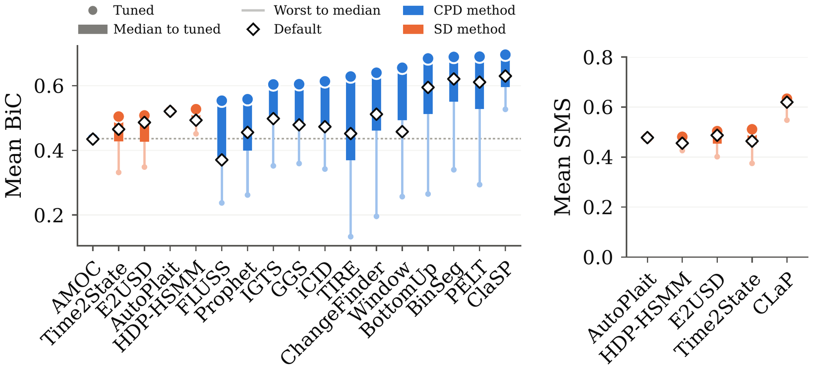
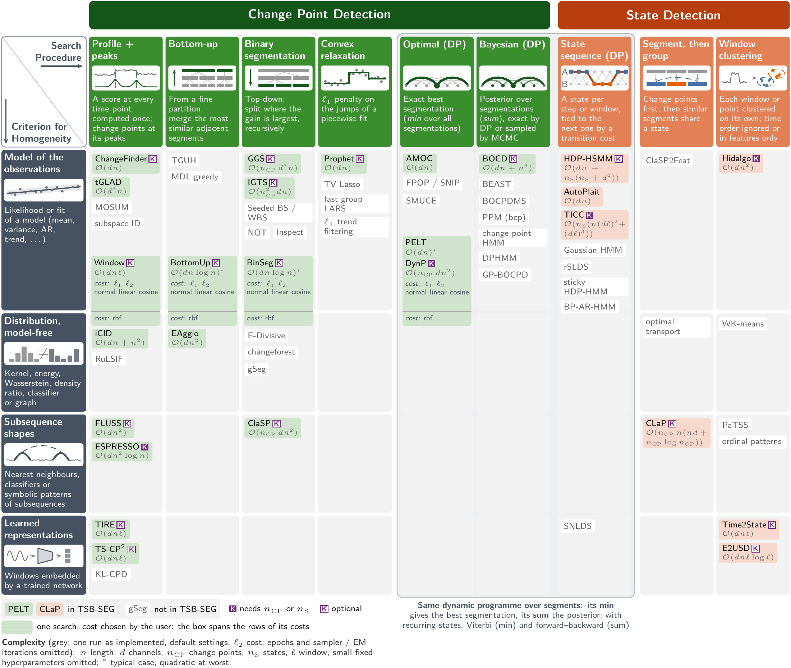

<p align="center">
  <picture>
    <source media="(prefers-color-scheme: dark)" srcset="assets/logo_dark.png">
    
  </picture>
</p>

<p align="center">
  <b>A systematic benchmark for time series segmentation</b><br>
  Change point detection and state detection: 26 algorithms, 592 series, 8 datasets, one reproducible pipeline
</p>

<!-- TODO(release): point the paper badge, the "Paper" link and the banner to the arXiv page. -->
<p align="center">
  <a href="#citation"></a>
  <a href="https://pypi.org/project/tsseg/0.3.0/"></a>
  <a href="https://www.python.org/"></a>
  <a href="LICENSE"></a>
  <a href="results/README.md"></a>
  <a href="https://github.com/astral-sh/ruff"></a>
</p>

<p align="center">
  <a href="#citation"><b>Paper</b></a> ·
  <a href="https://github.com/fchavelli/tsseg"><b>tsseg library</b></a> ·
  <a href="results/README.md"><b>Results</b></a> ·
  <a href="data/README.md"><b>Datasets</b></a> ·
  <a href="REPRODUCIBILITY.md"><b>Reproducibility</b></a>
</p>

<p align="center">
  <a href="#citation"></a>
</p>

## What is TSB-SEG?

**TSB-SEG** is a benchmark for **time series segmentation** that evaluates its
two formulations together: **change point detection** (CPD), which places the
boundaries between segments, and **state detection** (SD), which also tells
which segments share a recurring state. It asks what five decades of
segmentation methods achieve when they are compared on the same series, with
the same metrics and the same tuning budget.

<p align="center">
  
  <br>
  <sub>The two tasks on a motion-capture recording: CPD finds the six boundaries, SD must also
  recognise that the three walking segments, and the two punching ones, are the same state.</sub>
</p>

This repository holds the code, configurations and results of the paper. It is
frozen on the paper and changes only through errata (tagged `v1.0.x`); new
results and methods go to the online benchmark, not here. Every algorithm and
metric comes from [`tsseg`](https://github.com/fchavelli/tsseg), the library
that implements the methods of the benchmark behind one `fit`/`predict` API.

| Benchmark | Series | Univariate | Multivariate | CPD | SD | Algorithms |
| --- | ---: | :---: | :---: | :---: | :---: | ---: |
| UTSA (Gharghabi et al., 2018) | 32 | ✓ | | ✓ | | 3 |
| TCPD (van den Burg & Williams, 2020) | 42 | ✓ | ✓ | ✓ | | 14 |
| SKAB (Katser & Kozitsin, 2020) | 34 | | ✓ | ✓ | | 10 |
| TSSB (Ermshaus et al., 2023) | 75 | ✓ | | ✓ | | 7 |
| HAS (Ermshaus et al., 2023) | 250 | | ✓ | ✓ | | 13 |
| **TSB-SEG** | **592** | ✓ | ✓ | ✓ | ✓ | **26** |

## At a glance

- **592 labelled series from 8 datasets**, univariate and multivariate (up to
  10 channels, 240 to 56,251 time points, 0 to 78 change points, 1 to 43
  states), from human activity recognition, industrial monitoring and
  general-purpose collections, plus **PAMAP2** (up to 447k points per series)
  as a long-series scalability case study.
- **26 algorithms** spanning five decades, organised by how they search the
  segmentation and what must stay the same within a segment. A **main pool**
  of 21 methods (15 CPD, 6 SD) runs on every series and gives the ranking; an
  **extended-scope pool** gathers the 5 methods that cannot. 14 of them were
  absent from existing toolkits and were reimplemented or adapted in `tsseg`.
- **Two evaluation axes.** Each method runs its **Default** configuration and
  a **parameter grid** (tuned and worst-case scores per dataset, and the
  tuning gap between them), each **Non-Guided** (the method infers the number
  of change points or states) and **Guided** (the true number is given).
- **Metrics for both tasks**: Bidirectional Covering (BiC, primary), F1,
  Covering and Gaussian F1 for CPD; the State Matching Score (SMS, primary),
  ARI, AMI and WARI for SD. SD methods are also scored on CPD, through the
  change points their labels induce.
- **Every run is published**: 555,768 series runs of 10,259 configurations,
  as Parquet tables from which `make paper` rebuilds every figure and table of
  the paper in minutes.

## Key findings

1. **No method dominates.** The leaders change with the task, the mode and the
   dataset, and per-dataset tuning is decisive: for several CPD methods the
   gap between the best and the worst configuration reaches 0.35 to 0.50 BiC. Knowing
   the number of change points or states helps most methods.
2. **CPD accuracy is a useful, though imperfect, proxy for SD accuracy.** BiC
   and SMS are strongly correlated; the exceptions come from mislabelled
   segments (a clustering bottleneck) or from over-segmentation.
3. **Data characteristics should guide the choice.** For CPD, the fast
   penalised detectors (PELT, BinSeg, BottomUp; DynP when the number of change
   points is known) are the safest choice and scale to long series; ClaSP is
   preferable on univariate series with few events. For SD, CLaP leads on
   simple series, Time2State and E2USD on complex multivariate and long ones.
   Tuning a single window, penalty or threshold captures most of the gain.

<p align="center">
  
  <br>
  <sub>Non-Guided mode, mean over the 592 series. Left: BiC of every main-pool method on CPD (SD methods
  scored through the change points they induce). Right: SMS of the SD methods. Dot: tuned configuration;
  thick bar and thin stem: median and worst-case ones; diamond: default one.</sub>
</p>

## Algorithms

<p align="center">
  <a href="assets/taxonomy.png"></a>
  <br>
  <sub>Taxonomy of the paper: how a method searches the segmentation (columns) and what must stay the
  same within a segment (rows). Tinted: evaluated in TSB-SEG. Click to enlarge.</sub>
</p>

| Pool | Task | Algorithms |
| --- | --- | --- |
| Main | CPD (15) | [AMOC](https://fchavelli.github.io/tsseg/detectors/amoc.html), [BinSeg](https://fchavelli.github.io/tsseg/detectors/binseg.html), [BottomUp](https://fchavelli.github.io/tsseg/detectors/bottomup.html), [ChangeFinder](https://fchavelli.github.io/tsseg/detectors/changefinder.html), [ClaSP](https://fchavelli.github.io/tsseg/detectors/clap.html), [DynP](https://fchavelli.github.io/tsseg/detectors/dynp.html), [ESPRESSO](https://fchavelli.github.io/tsseg/detectors/espresso.html), [FLUSS](https://fchavelli.github.io/tsseg/detectors/fluss.html), [GGS](https://fchavelli.github.io/tsseg/detectors/ggs.html), [iCID](https://fchavelli.github.io/tsseg/detectors/icid.html), [IGTS](https://fchavelli.github.io/tsseg/detectors/igts.html), [PELT](https://fchavelli.github.io/tsseg/detectors/pelt.html), [Prophet](https://fchavelli.github.io/tsseg/detectors/prophet.html), [TIRE](https://fchavelli.github.io/tsseg/detectors/tire.html), [Window](https://fchavelli.github.io/tsseg/detectors/window.html) |
| Main | SD (6) | [AutoPlait](https://fchavelli.github.io/tsseg/detectors/autoplait.html), [CLaP](https://fchavelli.github.io/tsseg/detectors/clap.html), [E2USD](https://fchavelli.github.io/tsseg/detectors/e2usd.html), [HDP-HSMM](https://fchavelli.github.io/tsseg/detectors/hdp_hsmm.html), [TICC](https://fchavelli.github.io/tsseg/detectors/ticc.html), [Time2State](https://fchavelli.github.io/tsseg/detectors/time2state.html) |
| Extended scope | CPD (4) | [BOCD](https://fchavelli.github.io/tsseg/detectors/bocd.html), [E-Agglo](https://fchavelli.github.io/tsseg/detectors/eagglo.html), [tGLAD](https://fchavelli.github.io/tsseg/detectors/tglad.html), [TS-CP2](https://fchavelli.github.io/tsseg/detectors/tscp2.html) |
| Extended scope | SD (1) | [Hidalgo](https://fchavelli.github.io/tsseg/detectors/hidalgo.html) |

Each name links to the documentation page of the detector in `tsseg`, with
its parameters and original paper. `configs/algorithm/` holds the Default
configuration and the parameter grid of each one.

## Datasets

| Dataset | Domain | Series | Length | Channels | Change points | States |
| --- | --- | ---: | ---: | ---: | ---: | ---: |
| MoCap | human activity | 9 | 5k–11k | 4 | 5–10 | 3–9 |
| HAS | human activity | 250 | 0.3k–41k | 6–9 | 0–14 | 1–12 |
| ActRecTut | human activity | 2 | 31k–33k | 10 | 42 | 6 |
| USC-HAD | human activity | 70 | 25k–56k | 6 | 11 | 12 |
| PUMP | industrial monitoring | 120 | 20k–41k | 9 | 50–78 | 41–43 |
| SKAB | industrial monitoring | 34 | 0.7k–1.3k | 8 | 1–2 | 2 |
| UTSA | general purpose | 32 | 2k–40k | 1 | 1–2 | 2–3 |
| TSSB | general purpose | 75 | 0.2k–21k | 1 | 0–8 | 1–7 |
| PAMAP2 (scalability) | human activity | 9 | 8k–447k | 9 | 2–27 | 2–13 |

`python scripts/download_data.py` (or `make data`) downloads them into
`data/`. [`data/README.md`](data/README.md) gives the source and license of
each one; the labels are those of the original authors, without
re-annotation.

## What is in this repository

| Path | Content |
|---|---|
| `src/tsbseg/` | Experiment pipelines (Hydra + MLflow): Default and grid runs, Non-Guided and Guided modes, per-series timeouts |
| `configs/` | Hydra configurations: every algorithm (default instance and grid), dataset, metric and experiment of the paper |
| `benchmark/analysis/` | Code of every figure and table of the paper (`python -m analysis.paper`) |
| `benchmark/configs/`, `benchmark/typology.json` | Experiments read by the analysis, taxonomy of the methods |
| `benchmark/datasets/` | Per-series features and domains |
| `scripts/` | Data download, rebuild of the results database, SMS error breakdown |
| `results/` | Results of every run of the paper (Parquet, CC BY 4.0) |
| `data/` | Datasets: `python scripts/download_data.py` (see `data/README.md`) |
| `tests/` | Tests of the data loading, the pipelines and the published results |

## Reproduce the figures and tables of the paper

The results of every run of the paper are published as Parquet tables. No
experiment needs to be rerun to rebuild the paper.

```bash
conda env create -f environment.yml && conda activate tsbseg
pip install -e .
make results-db   # rebuilds results/results.db from the tables of results/
make paper        # writes every figure and table to figures/paper/
```

[`results/README.md`](results/README.md) describes the tables. They can also
be read directly:

```python
import pandas as pd

runs = pd.read_parquet("results/runs.parquet")  # one row per series run
configs = pd.read_parquet("results/configs.parquet")  # one row per configuration
```

## Rerun experiments

Experiments run through Hydra and log to MLflow. One algorithm on one dataset,
in the Default configuration, Non-Guided:

```bash
python scripts/download_data.py mocap
export MLFLOW_TRACKING_URI=sqlite:///$PWD/mlruns.db
python src/tsbseg/main.py algorithm=pelt dataset=mocap experiment=unsupervised
```

The four experiments of the paper are:

| Experiment config | Logged experiment | Mode |
|---|---|---|
| `experiment=unsupervised` | `non-guided-full-time-3` | Default, Non-Guided |
| `experiment=semi_supervised` | `guided-full-time-3` | Default, Guided (true number of change points or states given) |
| `experiment=grid_unsupervised_v3` | `grid-non-guided-v3` | Grid, Non-Guided |
| `experiment=grid_supervised_v3` | `grid-guided-v3` | Grid, Guided |

A grid experiment expands the `tunable_parameters` of the algorithm config
into a Cartesian product and runs one job per configuration; on a SLURM
cluster, add `hydra/launcher=slurm` (edit `configs/hydra/launcher/slurm.yaml`
for your partitions). The paper ran every series with a 24 h timeout, on CPU
nodes of one partition so that runtimes are comparable.

Rerunning an experiment does not reproduce every published number bit for bit:
see [`REPRODUCIBILITY.md`](REPRODUCIBILITY.md) for the library version, the
nondeterministic methods and the known deviations.

## Software versions

- [`tsseg` 0.3.0](https://pypi.org/project/tsseg/0.3.0/), installed by `pip install -e .` (see `pyproject.toml`).
  The methods that need PyTorch, TensorFlow, Prophet or stumpy come with
  `pip install -e ".[methods]"`.
- Python 3.12; `environment.yml` pins the versions of the cluster environment
  that ran the experiments, `requirements-analysis.txt` those of the
  environment that drew the figures.

## Citation

If you use TSB-SEG, its results or its protocol, please cite the paper:

```bibtex
@inproceedings{chavelli2026tsbseg,
  title     = {{TSB-SEG}: A Systematic Time-Series Segmentation Benchmark},
  author    = {Chavelli, F{\'e}lix and Ermshaus, Arik and Yang, Fan and
               Sch{\"a}fer, Patrick and Paparrizos, John and Boniol, Paul},
  booktitle = {Advances in Neural Information Processing Systems (NeurIPS),
               Evaluations and Datasets Track},
  year      = {2026}
}
```

Every method of the benchmark runs through `tsseg`; if you use the library,
please also cite it:

```bibtex
@inproceedings{tsseg2026,
  title     = {tsseg: An Interactive Toolkit for Time Series Segmentation},
  author    = {Chavelli, F{\'e}lix and Ermshaus, Arik and Yang, Fan and Sch{\"a}fer, Patrick and Paparrizos, John and Boniol, Paul},
  booktitle = {Machine Learning and Knowledge Discovery in Databases. Applied Data Science Track, Demo Track and Industrial Track},
  series    = {Lecture Notes in Computer Science},
  year      = {2026},
  pages     = {391--394},
  publisher = {Springer Nature Switzerland},
  doi       = {10.1007/978-3-032-37685-5_41}
}
```

The State Matching Score and WARI come from:

```bibtex
@inproceedings{chavelli2025interpretable,
  title     = {Toward Interpretable Evaluation Measures for Time Series Segmentation},
  author    = {Chavelli, F{\'e}lix and Boniol, Paul and Thomazo, Micha{\"e}l},
  booktitle = {Advances in Neural Information Processing Systems},
  year      = {2025}
}
```

Please also cite the datasets you use: [`data/README.md`](data/README.md)
lists their sources.

## Authors

- Félix Chavelli (Inria, ENS, CNRS, PSL, Paris)
- Arik Ermshaus (Humboldt-Universität zu Berlin)
- Fan Yang (The Ohio State University, Columbus)
- Patrick Schäfer (Humboldt-Universität zu Berlin)
- John Paparrizos (The Ohio State University, Columbus, and AUTh)
- Paul Boniol (Inria, ENS, CNRS, PSL, Paris)

## Acknowledgments

The experiments ran on the CLEPS infrastructure of Inria Paris. John Paparrizos
was partially supported by the National Science Foundation under Award
No. 2543459.

## License

Code: GNU Affero General Public License v3.0 ([`LICENSE`](LICENSE)). The
published results: CC BY 4.0. Each dataset keeps its own license
([`data/README.md`](data/README.md)).
